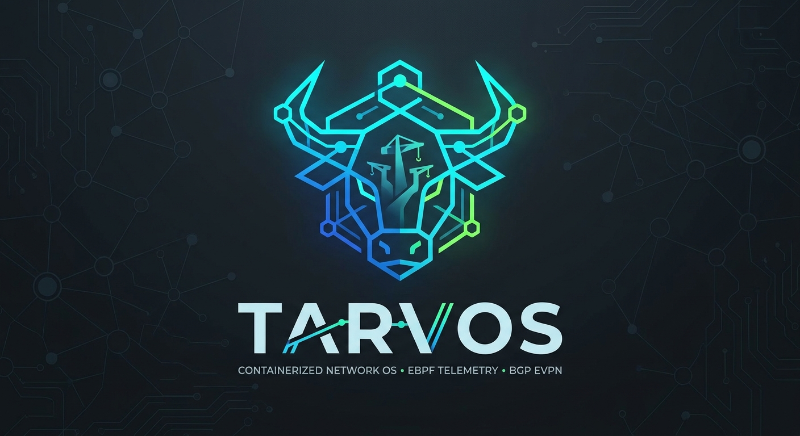

<p align="center">
  
</p>

<h1 align="center">Tarvos Network OS</h1>

<p align="center">
  <a href="https://github.com/devogs/tarvos/actions/workflows/ci-cd.yml"></a>
  <a href="https://hub.docker.com/r/matt13290/tarvos"></a>
  <a href="https://hub.docker.com/r/matt13290/tarvos"></a>
  <a href="LICENSE"></a>
</p>

Lightweight, open-source Network OS designed to bring carrier-grade BGP EVPN routing, SDN orchestration, and real-time kernel telemetry to any containerized network lab. Built to replace heavy proprietary virtual routers with a fast, standards-driven appliance.

Debian bookworm-slim + FRRouting + Sysrepo/Netopeer2 (NETCONF) + OpenSSH, with TACACS+ AAA, rsyslog and the management interface in its own VRF.

## Highlights

- **Routing:** FRRouting (BGP, OSPF, IS-IS, BFD) ready for BGP EVPN labs.
- **Model-driven management:** NETCONF through Sysrepo/Netopeer2, with YANG modules loaded dynamically from `/opt/tarvos/yangs`.
- **AAA:** TACACS+ with ordered failover and a local break-glass `admin`.
- **Isolated management plane:** `eth0` lives in VRF `mgmt` by default.
- **Observability:** rsyslog to stdout, optional forwarding to remote collectors.
- **Small and fast:** about 64 MB compressed, boots in under 10 s, uses about 35 MiB of RAM.

## Get the image

```bash
docker pull matt13290/tarvos:latest      # or a pinned release, e.g. :v1.0.0
```

## Quick start

```bash
cp .env.example .env     # edit it, see below
docker compose up --build
ssh -p 2222 admin@localhost          # password: ADMIN_PASSWORD (default "admin")
ssh -p 8300 -s admin@localhost netconf
```

The container needs `NET_ADMIN`, `NET_RAW` and `SYS_ADMIN` (FRR's zebra/bgpd require the last for VRF/netns handling); see `docker-compose.yml`.

Custom YANG modules mounted at `/opt/tarvos/yangs` are registered in Sysrepo at every boot, before Netopeer2 starts.

## Configuration (environment, see `.env.example`)

| Variable | Purpose |
|---|---|
| `ADMIN_PASSWORD` | Password of the local `admin` account (default `admin`, **change it**) |
| `TACACS_SERVER`, `TACACS_SECRET`, `TACACS_TIMEOUT` | TACACS+ servers (ordered, failover), shared secret |
| `SYSLOG_SERVER`, `SYSLOG_PORT`, `SYSLOG_PROTOCOL`, `SYSLOG_MIN_SEVERITY` | Optional remote syslog forwarding (logs always go to stdout too) |
| `MGMT_VRF_ENABLED`, `MGMT_VRF_NAME`, `MGMT_VRF_TABLE`, `MGMT_INTERFACE` | Management VRF (default: `eth0` in VRF `mgmt`) |
| `SSH_PORT`, `NETCONF_PORT`, `LOG_LEVEL`, `YANG_DIR` | Runtime parameters |

## Security notes

- **Change `ADMIN_PASSWORD`.** The default `admin`/`admin` is public knowledge. The container logs a warning while it is in use. Do not expose port 22/830 of a default container to untrusted networks.
- `admin` is the break-glass account: it never waits on TACACS+ and keeps working when TACACS+ is down. TACACS+ users are mapped to a shared unprivileged local account.
- The TACACS+ secret is written only to root-only (`0600`) PAM files and is never logged. Over NETCONF, `admin` can write it but not read it back.
- NETCONF access is controlled by NACM: only `admin` has access.

## Known limitations

- TACACS+ users can log in over SSH but not over NETCONF (only `admin` is a NETCONF user).
- Remote syslog forwarding is unit-tested but not yet tested against a real collector; `sysrepo-plugind` and `netopeer2-server` log to stdout only.
- Netopeer2 advertises the `yang-library` capability and serves modules via `<get-schema>`; it does not list every module in its `<hello>`.
- Image is `linux/amd64` only.

## Development

`feature` -> PR to `qa` (lint, unit tests, build, Trivy, integration tests incl. TACACS+, baseline metrics) -> PR to `main` (same checks, then push to Docker Hub as `matt13290/tarvos` with tags `latest`, `vX.Y.Z` from `VERSION`, and the commit SHA). Bump `VERSION` for every merge to `main`.
